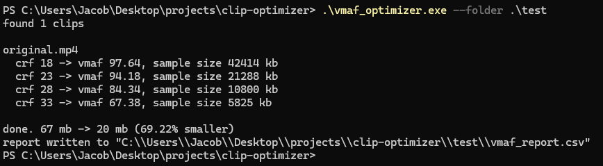

# vmaf-optimizer

Works out the right compression setting for a folder of game clips instead of
guessing at one.

OBS writes 1080p60 at 30-40 Mbps and most clips don't need anywhere near that.
The problem is the right CRF depends on the footage. A quiet menu screen and a
firefight compress completely differently, so one value across the whole library
either wastes space on the easy clips or smears the busy ones.

Rather than settle on a single value, the tool determines one per clip. It
extracts a 20 second sample so the search doesn't require re-encoding the full
file at every step, encodes that sample across a range of CRF values, and scores
each result against the source sample using VMAF, the perceptual quality metric
Netflix developed to judge encode quality across their own catalog. The smallest
encode that still meets the quality floor is applied to the full clip. If nothing
reaches the floor, the highest scoring setting is used and the report marks the
clip as having failed it.

In this example the clip dropped from 67 MB to 20 MB. CRF 28 would have been
half that size again, but it scored too far under the floor, so 23 was used.

About 70 seconds for a 15 second 1080p60 clip on a Ryzen 7 7700X. It's all CPU
work, x264 and libvmaf never touch the GPU, so core count is what moves that
number. The sweep always runs on a 20 second sample no matter how long the clip
is, so past a minute or so the final encode is most of the wait.

## Requires

ffmpeg and ffprobe on PATH, built with libvmaf:

    ffmpeg -version | findstr libvmaf

## Build

    g++ -std=c++17 -O2 -static vmaf_optimizer.cpp -o vmaf_optimizer.exe

## Usage

    vmaf_optimizer --folder .\clips

Compressed copies go to `clips\optimized\` and the originals are left alone. A
`vmaf_report.csv` lands next to them with the chosen CRF and score per clip.

| flag | |
| --- | --- |
| `--folder` | folder to scan, not recursive |
| `--min-vmaf` | quality floor |
| `--codec` | libx264 or libx265 |
| `--preset` | ffmpeg preset |
| `--crf` | values to try |
| `--replace` | shrink in place, originals moved to `_originals_backup` |
| `--debug` | log every ffmpeg command to ffmpeg_debug.log |

Run it with no arguments for the defaults.
